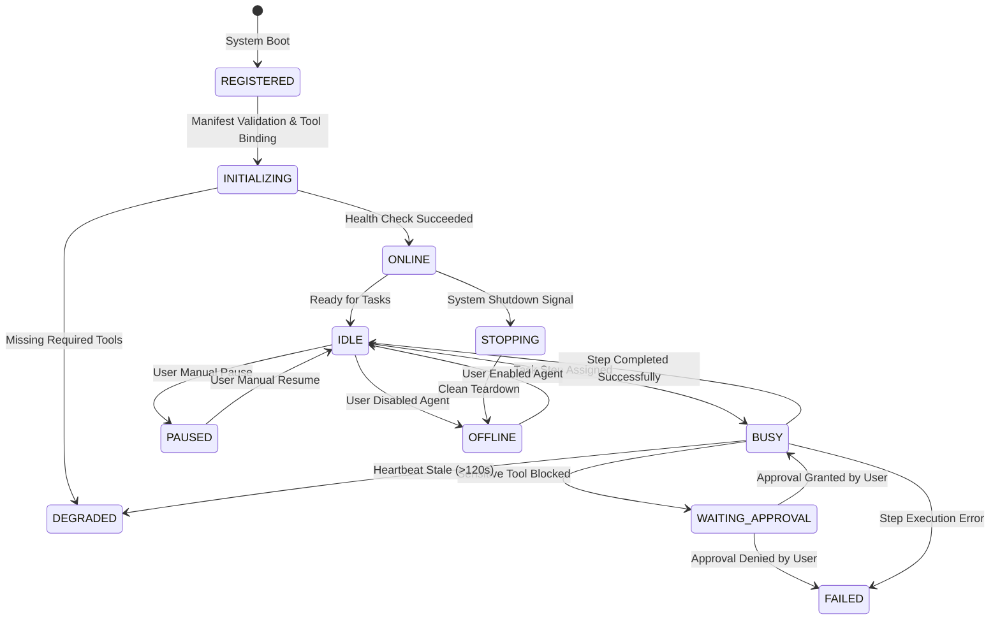

# Jarvis V1 — Agent Lifecycle & Runtime State Machine

## 1. Discrete Runtime States

Every agent in the workforce transitions strictly through 11 discrete lifecycle states defined in `openjarvis.workforce.models.AgentRuntimeState`.

---

## 2. State Descriptions

| State | Enum Value | Description |
| :--- | :--- | :--- |
| **REGISTERED** | `registered` | Manifest loaded from disk or definition; not yet verified against runtime. |
| **INITIALIZING** | `initializing` | Tool dependencies and inference model bindings are being verified. |
| **ONLINE** | `online` | Agent is loaded and healthy, ready to receive task assignments. |
| **IDLE** | `idle` | Agent is waiting for work; zero GPU memory consumption. |
| **BUSY** | `busy` | Agent is actively executing a task step or DAG operation. |
| **WAITING_APPROVAL** | `waiting_approval` | Execution paused waiting for human explicit approval on a sensitive tool. |
| **PAUSED** | `paused` | Agent temporarily suspended by user instruction or task pause. |
| **DEGRADED** | `degraded` | Agent operational but missing optional tools or heartbeat timed out. |
| **OFFLINE** | `offline` | Agent disabled by user or administrative configuration. |
| **FAILED** | `failed` | Unrecoverable error encountered during task execution. |
| **STOPPING** | `stopping` | Server shutdown initiated; draining in-flight steps cleanly. |

---

## 3. Heartbeat & Presence Tracking

- **Heartbeat Daemon:** A dedicated background thread in `AgentWorkforceRegistry` sweeps active workers every 15 seconds.
- **Heartbeat Payload:** Records `agent_id`, `status`, `timestamp`, `current_task_id`, `active_model`, `runtime_health`, and `current_workload`.
- **Stale Detection:** If an agent remains in `BUSY` without a heartbeat update for > 120 seconds, it is automatically marked `DEGRADED` and logged in the SQLite WAL team events log.

---

## 4. Startup & Shutdown Handlers

### Server Startup (`src/openjarvis/server/app.py`):
1. **BackgroundTaskEngine:** Discovers interrupted tasks in `tasks.db` and recovers them to their last checkpointed step.
2. **RoutineEngine:** Reconciles missed scheduled runs and starts the background schedule loop.
3. **AgentWorkforceRegistry:** Loads 7 specialist manifests, ensures required tools are registered in `ToolRegistry`, records initial heartbeats, and starts the heartbeat monitor daemon.
4. **Voice Pipeline:** Announces workforce readiness if current time is outside quiet hours (`Asia/Kolkata`).

### Server Shutdown:
1. Stops agent heartbeat monitor.
2. Quiesces routine scheduler loop.
3. Drains in-flight background workers within grace periods.
