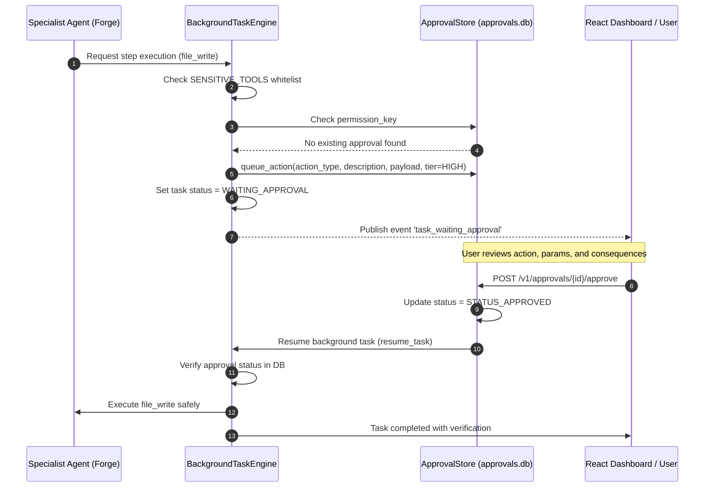

# Jarvis V1 — Agent Security, Capabilities & Approval Architecture

## 1. Security Principles

Jarvis V1 enforces a zero-trust model between autonomous AI agents and local system operations:

1. **Explicit Human Approval for Sensitive Actions:** Irreversible or potentially destructive operations always require fresh, explicit human approval.
2. **Hard Enforcement in Code:** Security gates are enforced in Python backend code and database constraints, never trusted to LLM system prompts.
3. **No Self-Approval:** AI models can never approve their own actions or inject spoofed approval parameters.
4. **Agent Capability Isolation:** Agents are restricted to explicit tool whitelists; denied tools cannot be executed regardless of user prompts.

---

## 2. Sensitive Action Taxonomy

The following tool calls are classified as sensitive and automatically halted for approval:

| Tool Name | Operation Type | Security Threat | Approval Tier |
| :--- | :--- | :--- | :--- |
| `file_write` | Filesystem modification | Overwriting code, deleting files, data loss | **High** (Explicit human check) |
| `file_delete` | Filesystem removal | Destruction of project assets | **High** (Explicit human check) |
| `shell_exec` | Terminal execution | Command injection, unauthorized network/process calls | **High** (Explicit human check) |
| `desktop` | GUI Control / Mouse / Keys | Unauthorized desktop actions | **High** (Explicit human check) |
| `channel_send` | Messaging (SMS, email) | Unsolicited external communication | **High** (Explicit human check) |

---

## 3. Approval Flow & Backend Enforcement

---

## 4. Capability Profiles

In addition to individual specialist whitelists/blacklists, Jarvis enforces four core capability profiles:

- **`research`**: Permits web search, knowledge search, and local file reading. Strictly blocks shell, file write, desktop control, and external messaging.
- **`coding`**: Permits reading project files, writing permitted files with approval, test execution via shell, and git inspection. Blocks desktop automation and messaging.
- **`monitor`**: Permits local file reading and system telemetry. Blocks all write operations.
- **`general`**: Standard operations governed by the Approval Gateway.

---

## 5. Prevention of Self-Approval & Spoofing

Any attempt by an LLM prompt or tool payload to provide parameters like `approved=True` or `skip_approval=True` is completely ignored. The `BackgroundTaskEngine` queries the persistent SQLite `approvals.db` directly by fingerprint:
`task:{task_id}:step:{step_number}:{tool_name}`

Only an explicit HTTP request to `/v1/approvals/{action_id}/approve` from an authenticated human session can transition an action to `approved`.
