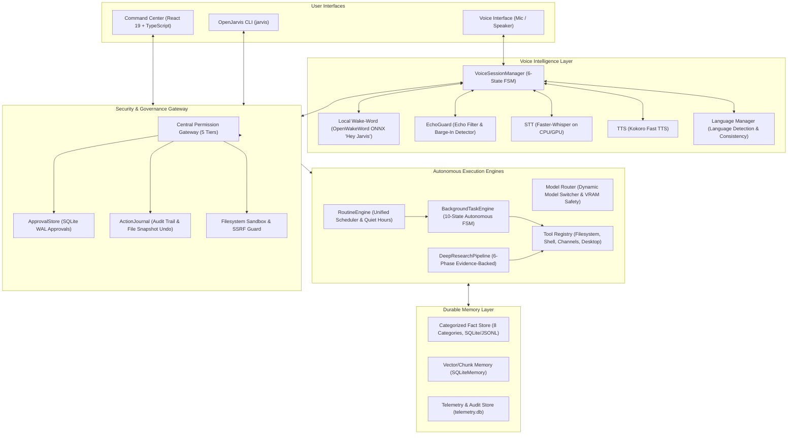

# Jarvis System Architecture (Mark-LVII Upgrade)

## 1. Executive Summary

This document describes the production architecture of **OpenJarvis (Mark-LVII Upgrade)**, transforming Jarvis V1 into a reliable, highly autonomous, persistent, voice-enabled personal AI assistant. The system is specifically engineered to deliver low-latency local execution, background autonomy, and verifiable security on personal workstation hardware:

- **Host Profile:** AMD Ryzen 5 5600H (6 cores, 12 threads), 16 GB System RAM, NVIDIA GeForce GTX 1650 (4 GB GDDR6 VRAM), Windows 11.
- **Core Philosophy:** Local-first execution, strict hardware budget sandboxing (avoiding multi-model VRAM exhaustion), zero silent failures, and backend-enforced fresh explicit user approvals for all sensitive operations.

---

## 2. Architecture Overview & Component Diagram

---

## 3. Subsystem Architectural Details

### 3.1 Advanced Voice Intelligence Layer
- **Local Wake-Word Detection (`src/openjarvis/speech/session_manager.py`):**
  Uses a local, quantized ONNX model (`hey_jarvis.onnx` via OpenWakeWord). Audio streaming runs in a lightweight thread on CPU without waking GPU weights.
- **Self-Echo & Barge-In Protection (`src/openjarvis/speech/echo_guard.py`):**
  Solves Bluetooth speaker echo loops using stateful playback tracking, a 500ms post-playback guard window, and energy thresholding. Recognizes interrupt keywords (`stop`, `wait`, `cancel`, `hold on`, `pause`) during playback to immediately stop speech without disabling microphone input.
- **Speech-to-Text & Text-to-Speech:**
  Faster-Whisper processes speech chunks with configurable VAD (`silero_vad`). Kokoro TTS streams high-quality audio in chunked buffers.
- **Language Consistency (`src/openjarvis/speech/language.py`):**
  Detects language script (English, Hindi, Japanese, Chinese, Spanish, French, German) and directs the assistant to respond in the user's spoken language while selecting native Kokoro voice models.

### 3.2 Persistent Autonomous Background Task Engine
Located in `src/openjarvis/tasks/`:
- **10-State Finite State Machine (`TaskStatus`):**
  `CREATED` → `PLANNING` → `RUNNING` ⇄ `WAITING_APPROVAL` / `PAUSED` / `RECOVERING` → `VERIFYING` → `COMPLETED` / `FAILED` / `CANCELLED`.
- **Checkpointing & Crash Recovery (`TaskCheckpoint`):**
  Every step is persisted to SQLite (`tasks.db`) with an idempotency key before execution. If the process is terminated or crashes, `recover_on_startup()` restores active tasks to `RECOVERING` or `RUNNING` without duplicating completed side-effects.
- **Dynamic Steering:**
  Users can inject steering instructions into a running background task via voice ("Jarvis, focus on X instead") or the UI steering modal.
- **Capability Profiles:**
  Enforces sandboxed tool scopes (`research`, `coding`, `monitor`, `general`) to isolate long-running operations.

### 3.3 Unified Routines & Scheduling Engine
Located in `src/openjarvis/routines/`:
- **Schedule Types:** One-time, daily, weekly, interval, cron, and startup routines.
- **Quiet-Hours Enforcement (`src/openjarvis/routines/quiet_hours.py`):**
  Configured for `Asia/Kolkata` (22:00-07:00). During quiet hours, unsolicited voice synthesis is suppressed; notifications are queued until the quiet window concludes.
- **Missed-Run Catchup:**
  When Jarvis restarts after being offline, missed schedules are evaluated and caught up sequentially without backlog flooding.

### 3.4 Deep Research & Evidence Verification Engine
Located in `src/openjarvis/research/`:
- **6-Phase Execution Pipeline:**
  1. `PLAN`: Deconstructs query into verified subtopics and evidence requirements.
  2. `INVESTIGATE`: Queries web and local knowledge connectors while enforcing SSRF security (`is_safe_target_url`).
  3. `EXTRACT EVIDENCE`: Gathers declarative passages, exact quotes, and source metadata into `EvidenceItem`.
  4. `REVIEW`: Synthesizes findings, identifies comparisons, and separates verified facts from assumptions.
  5. `WRITE`: Compiles a structured research report artifact.
  6. `VERIFY`: Cross-references every cited quotation against raw source text, marking verified items with `✓ Verified` and reporting unverified quotes.
- **Markdown Artifacts:**
  Reports are rendered into GitHub-flavored Markdown artifacts with executive summaries, technical comparisons, and reference tables stored in `~/.openjarvis/reports/`.

### 3.5 Categorized Long-Term Memory
Located in `src/openjarvis/memory/`:
- **Taxonomy:** 8 distinct memory categories (`preferences`, `projects`, `environment`, `decisions`, `tasks`, `goals`, `facts`).
- **Deduplication & Provenance:**
  Prevents duplicate entries; retains trust provenance (`trusted`, `auto`, `untrusted`) and supports pin/unpin toggles.
- **Management API:**
  Full REST CRUD endpoints for viewing, searching, updating, pinning, and deleting facts.

### 3.6 Central Security Gateway & Action Journal
Located in `src/openjarvis/security/`:
- **5 Permission Tiers:**
  - `READ_ONLY`: Autonomous execution permitted (reading allowed paths, querying stats).
  - `SAFE_LOCAL`: Autonomous execution permitted (read-only tools, directory listing).
  - `REVERSIBLE_LOCAL`: Permitted with mandatory pre-modification backup snapshot.
  - `SENSITIVE`: Mandatory fresh explicit user approval required (shell execution, code writing, channel messaging, external requests).
  - `IRREVERSIBLE`: Mandatory fresh explicit user approval required with critical risk warning.
- **Fresh Approval Policy:**
  High-risk and sensitive actions require fresh explicit user approval every time. AI models are strictly blocked from self-approving actions.
- **Action Journal & Undo (`src/openjarvis/security/action_journal.py`):**
  Records an audit log of all privileged actions. Before modifying or deleting a file, a pre-modification snapshot is preserved in `.openjarvis/backups/`. Reversing the action restores the file from the snapshot.

### 3.7 Runtime Capability Registry & Dynamic Model Router
Located in `src/openjarvis/core/capabilities.py` and `src/openjarvis/engine/router.py`:
- **Hardware Telemetry:** Dynamically detects CPU model, RAM metrics, and NVIDIA GTX 1650 GPU VRAM allocation.
- **VRAM Safeguards:** Enforces strict 4 GB VRAM limits, warning the user and preventing concurrent high-parameter model allocations that would trigger out-of-memory faults.
- **Voice-Controlled Switching:** Responds to voice or chat commands ("Switch to Qwen", "Which model are you using?") to dynamically select inference models.
