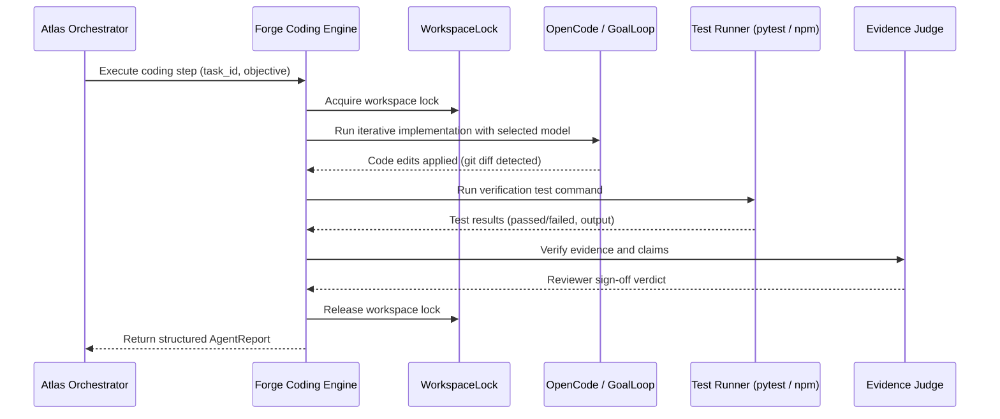

# Jarvis FORGE Coding Engine & Native Workflow Integration

## 1. Overview & Problem Solved

Previously, FORGE executed generic, single-turn tool calls without full access to OpenJarvis's native coding system. The new **FORGE Coding Engine** (`src/openjarvis/workforce/forge_coding.py`) seamlessly connects FORGE to:
1. Jarvis's native **GoalLoop** (`src/openjarvis/coding/goal.py`).
2. Specialist roles (`roles.build`, `roles.review`, `roles.explore`) respecting `AGENTS.md` and repository instructions.
3. The headless **OpenCodeAgent** (`src/openjarvis/agents/opencode.py`).
4. Robust **Workspace File Locking** to prevent concurrent step file corruption.
5. Automated **Test Verification** that validates code modifications before reporting completion.

---

## 2. Workspace File Locking

Concurrent agent steps modifying the same files lead to git merge conflicts and corrupted syntax. `WorkspaceLock` provides thread-safe and process-safe locking:

```python
with WorkspaceLock.acquire(target_dir=project_path, files=["src/auth.py"]):
    # Safe to read, patch, edit, and compile code
    ...
```

- Blocks conflicting steps until the active coding operation completes.
- Provides configurable timeout safeguards (default: 30 seconds).

---

## 3. End-to-End Execution Flow



---

## 4. Structured Agent Report

FORGE produces a verified `AgentReport` containing:
- `files_inspected`: Files discovered and read during investigation.
- `files_changed`: List of modified files detected via `git status --porcelain`.
- `tests_executed`: Command, execution duration, exit code, and stdout/stderr.
- `evidence`: Detailed execution artifacts and reviewer verdicts.
- `confidence`: Confidence score (0.0 to 1.0) scaled by verification evidence.
- `suggested_next_action`: Actionable next recommendation for Atlas.
