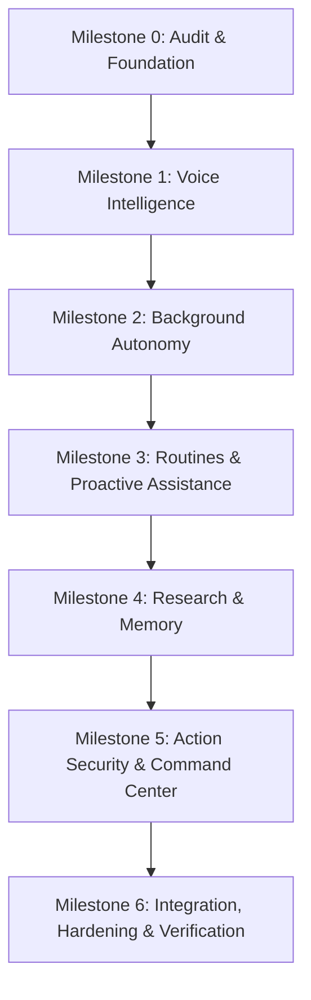

# Jarvis V1 Upgrade Implementation Plan
**Objective:** Transform Jarvis V1 into a Highly Autonomous, Persistent, Voice-Enabled Personal AI Assistant (Mark-LVII standard)  
**Hardware Profile:** AMD Ryzen 5 5600H, NVIDIA GTX 1650 (4 GB VRAM), 16 GB RAM, Windows 11  
**Architecture Principle:** Extend existing modules, preserve working test baselines, enforce backend-driven security, and deliver fully integrated production code.

---

## Milestone Roadmap

---

## Milestone 0 — Audit & Foundation
- **Goal:** Document baseline, secure filesystem defaults, establish central permission tiers, and verify test baseline.
- **Tasks:**
  1. Produce `docs/JARVIS_ARCHITECTURE_AUDIT.md`, `docs/JARVIS_FEATURE_STATUS.md`, `docs/JARVIS_IMPLEMENTATION_PLAN.md`.
  2. Implement safe-by-default filesystem policy in `src/openjarvis/tools/_paths.py`, `file_read.py`, `file_write.py`, and `core/config.py`:
     - If `allowed_dirs` is empty, restrict access to the user's workspace directory (`~/.openjarvis` and current workspace root) rather than granting full disk access.
     - Add canonical path validation, traversal detection, and symlink escape checks.
  3. Define 5 Permission Tiers and capability profiles in `src/openjarvis/security/types.py` and `security/boundary.py`:
     - `READ_ONLY`
     - `SAFE_LOCAL`
     - `REVERSIBLE_LOCAL`
     - `SENSITIVE`
     - `IRREVERSIBLE`
  4. Verify existing tests pass across core, speech, workflow, memory, and tools.

---

## Milestone 1 — Advanced Voice Assistant
- **Goal:** Robust, continuous voice interaction with wake-word activation, barge-in, self-echo prevention, instant acknowledgment, and language consistency.
- **Tasks:**
  1. **Voice Session Manager (`src/openjarvis/speech/session_manager.py`):**
     - Finite state machine: `IDLE`, `WAKE_LISTENING`, `ACTIVE_LISTENING`, `PROCESSING`, `SPEAKING`, `INTERRUPTED`.
     - Support continuous listening mode, push-to-talk, and wake-word trigger ("Hey Jarvis").
  2. **Wake-Word Integration (`src/openjarvis/wake/`):**
     - Integrate `openwakeword` with lightweight ONNX model running on CPU.
     - Audible chime on activation; transition session to `ACTIVE_LISTENING`.
  3. **Self-Echo & Audio Loop Protection (`src/openjarvis/speech/echo_guard.py`):**
     - Track active audio playback state via atomic counter/event.
     - Post-playback guard interval (configurable 300-800ms) to absorb speaker-to-mic reverb.
     - Barge-in voice activity detection: allow speech interruption when the user utters stop words ("stop", "wait", "hold on", "cancel") while suppressing feedback loops.
  4. **Centralized Language Management (`src/openjarvis/speech/language.py`):**
     - Automatic language detection on user input.
     - Preserve user language for output generation and TTS voice selection.
  5. **Instant Voice Acknowledgment:**
     - Pre-task verbal acknowledgments for long operations before spawning background workers.
  6. **Voice Device & Settings API:**
     - Endpoints for enumerating microphones/speakers, testing audio, and configuring voice properties.

---

## Milestone 2 — Persistent Autonomous Background Task Engine
- **Goal:** Long-running task engine that plans, checkpoints, survives crashes, allows steering, and respects resource budgets.
- **Tasks:**
  1. **Task Data Model & SQLite Persistence (`src/openjarvis/tasks/` or `agents/tasks.py`):**
     - Tables: `background_tasks`, `task_steps`, `task_checkpoints`, `task_events`, `task_artifacts`.
     - 10-State Lifecycle: `CREATED`, `PLANNING`, `RUNNING`, `WAITING_APPROVAL`, `PAUSED`, `RECOVERING`, `VERIFYING`, `COMPLETED`, `FAILED`, `CANCELLED`.
  2. **Step Checkpointing & Idempotency:**
     - Store request, plan, current step index, completed steps, pending steps, tool calls, results, token/time budget, artifacts, and verification status.
     - Assign unique idempotency keys to external side effects.
  3. **Crash Recovery & Resume on Startup:**
     - On server startup, detect interrupted tasks and safely transition to `RECOVERING` or `PAUSED`, resuming without repeating executed actions.
  4. **Task Steering:**
     - Support commands via API and voice: "what are you working on?", "pause task", "resume task", "stop task", "skip step", "change direction".
  5. **Resource Budgets & Agent Sandboxing:**
     - Enforce limits: max runtime, max tool calls, max model calls/tokens, max retries.
     - Restrict background agents by capability profile (e.g. Research Agent has no shell/file write/send capabilities).

---

## Milestone 3 — Unified Routines and Scheduling
- **Goal:** Single, robust routine scheduler for one-time, daily, weekly, interval, and startup actions with quiet-hour management.
- **Tasks:**
  1. **Unified Routine Engine (`src/openjarvis/routines/`):**
     - Support: One-time, Daily, Weekly, Monthly, Every N minutes/hours, Startup, Inactivity.
     - Persistent storage: `routines`, `routine_runs`, `routine_events`.
  2. **Quiet Hours Enforcement:**
     - Configurable timezone (`Asia/Kolkata` default) and quiet hours window (e.g. 22:00 - 07:00).
     - Suppress unsolicited voice output during quiet hours; queue non-critical notifications.
  3. **Missed Execution Handling:**
     - Inspect last run timestamps on startup; execute eligible missed routines safely without cascading repeats.
  4. **Routine Management APIs & Router:**
     - Endpoints for listing, creating, updating, pausing, resuming, triggering, and viewing history.

---

## Milestone 4 — Advanced Deep Research Engine & Long-Term Memory
- **Goal:** Evidence-backed research workflow with quote verification, coupled with categorized long-term memory and session continuity.
- **Tasks:**
  1. **6-Phase Deep Research Workflow (`src/openjarvis/research/`):**
     - `PLAN` -> `INVESTIGATE` -> `EXTRACT EVIDENCE` -> `REVIEW` -> `WRITE` -> `VERIFY`.
     - Evidence Store: URL, page title, access date, relevant passage, exact quotation, content hash.
  2. **Quotation & Citation Verification:**
     - Before report finalization, check that cited facts and exact quotations exist in retrieved page texts.
  3. **Report Artifact Generator:**
     - Format structured Markdown reports with executive summary, methodology, findings, comparisons, recommendations, limitations, and references.
     - Save reports in `~/.openjarvis/reports/` with versioning.
  4. **Web Security & SSRF Protection:**
     - Block private IP ranges (127.0.0.0/8, 10.0.0.0/8, 172.16.0.0/12, 192.168.0.0/16, 169.254.169.254).
     - Protect against prompt injection embedded in fetched pages.
  5. **Categorized Long-Term Memory (`src/openjarvis/memory/`):**
     - Memory categories: Preferences, Projects, Technical Environment, Tools, Decisions, Ongoing Tasks, Goals, Facts.
     - Deduplication and contradiction detection.
     - Full CRUD API (list, search, update, delete, pin, provenance).
  6. **Session Continuity:**
     - Maintain session summaries and cross-session ongoing task context.

---

## Milestone 5 — Centralized Action Security, Capability Registry & Command Center UI
- **Goal:** Unbreakable permission gating for sensitive actions, action journaling with undo, runtime self-awareness, model routing, and frontend command center.
- **Tasks:**
  1. **Central Permission Gateway & Mandatory Approval (`src/openjarvis/security/`):**
     - Intercept all sensitive/irreversible operations (shell execution, file deletion, code commits, emails/messages, system changes).
     - Fresh explicit user approval required for every sensitive action. AI cannot approve its own action.
  2. **Action Journal & Undo/Compensation (`src/openjarvis/tools/journal.py`):**
     - Record Action ID, user request, tool name, parameters, approval ID, result, verification status, and reversibility.
     - Automatic pre-modification file backups to support file rollback/undo.
  3. **Runtime Capability Registry (`src/openjarvis/core/capabilities.py`):**
     - Live hardware discovery: CPU (Ryzen 5600H), RAM (16 GB), GPU (GTX 1650 4 GB VRAM via NVML/nvidia-smi), disk.
     - Real-time status of engines, models, speech, wake word, tools, permissions, and active background tasks.
     - Assistant introspection: honesty in answering questions about system capabilities and current state.
  4. **Model Routing & Resource Manager:**
     - Route tasks based on complexity and hardware capacity.
     - Voice-controlled model switching ("Switch to Qwen", "Which model are you using?").
  5. **Frontend Command Center UI (`frontend/src/`):**
     - Unified Command Center Dashboard.
     - Background Task Manager panel (live steps, progress, steering buttons).
     - Approval Center (pending actions, risk inspection, approve/deny).
     - Routine Manager (schedules, quiet hours, execution log).
     - Memory Browser (categories, search, edit, delete, pin).
     - Voice Settings (mic/speaker selector, wake-word toggle, speech test).

---

## Milestone 6 — Integration, Hardening & Verification
- **Goal:** Production-grade end-to-end integration, performance benchmarking, security validation, and documentation.
- **Tasks:**
  1. End-to-end integration tests for voice, background tasks, routines, research, memory, approvals, and capability registry.
  2. Security validation: test prompt injection, path traversal, SSRF, approval bypass prevention.
  3. Hardware benchmarks: measure CPU/RAM/VRAM consumption on Ryzen 5600H + GTX 1650.
  4. Final documentation: `JARVIS_ARCHITECTURE.md`, `JARVIS_API.md`, `JARVIS_SECURITY.md`, `JARVIS_SETUP.md`, `JARVIS_PERFORMANCE.md`, `JARVIS_CHANGELOG.md`.
