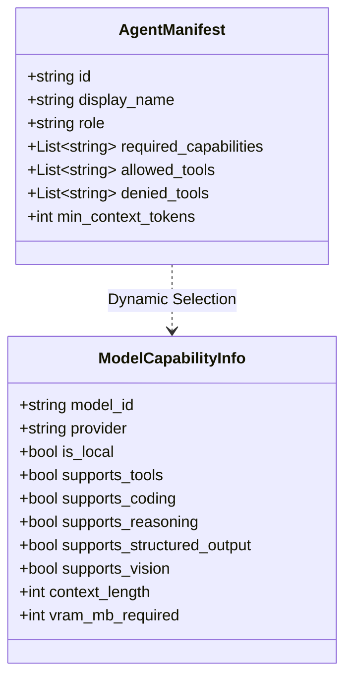

# Jarvis Model Capabilities & Specialist Mapping

## 1. Core Capability Dimensions

Modern LLMs exhibit distinct capability profiles. Rather than treating all models as interchangeable text generators, OpenJarvis models each discovered LLM along five verified dimensions:

| Capability | Definition | Specialist Consumer |
| :--- | :--- | :--- |
| **`tool_calling`** | Ability to parse tool schemas, produce valid tool calls with argument types, and handle tool feedback. | Atlas, Forge, Scout, Pulse |
| **`structured_output`** | Guaranteed JSON schema adherence without Markdown fences or conversational drift. | Atlas (DAG generation), Vanguard (verdicts) |
| **`coding`** | Code synthesis, refactoring, patch generation, syntax correctness, and test authorship. | Forge (Software Engineering) |
| **`reasoning`** | Deep multi-step chain-of-thought, technical trade-off evaluation, and verification. | Oracle (Research), Sentinel (Security) |
| **`vision`** | Multimodal comprehension of diagrams, architecture charts, UI mockups, and terminal screenshots. | Scout (Asset inspection) |

---

## 2. Workforce Specialist Requirements

Each specialist agent manifest defines its required capability set independently of model names:

### Specialist Profiles:
- **ATLAS**: `["planning", "reasoning", "structured_output", "tool_calling"]`
- **ORACLE**: `["research", "reasoning", "long_context", "evidence_extraction"]`
- **FORGE**: `["coding", "tool_calling", "code_analysis"]`
- **SENTINEL**: `["security", "audit", "permission_governance"]`
- **SCOUT**: `["file_search", "document_discovery"]`
- **VANGUARD**: `["qa_verification", "structured_output", "claim_verification"]`
- **PULSE**: `["tool_calling", "operations", "scheduling"]`
