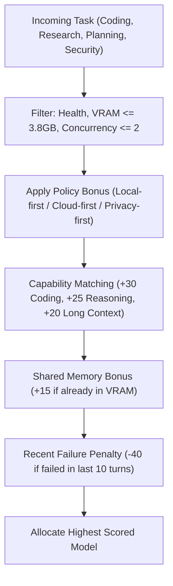

# Jarvis Hardware-Aware Model Selection Engine

## 1. Architectural Overview

The **Model Selection Engine** (`src/openjarvis/models/selector.py`) dynamically allocates the optimal discovered AI model for any given specialist agent or task. It replaces all hardcoded model mappings with a scoring function conditioned on task type, host hardware limits, and operational policy.

---

## 2. Hardware Profile & Governance

Jarvis operates on the user's host machine with strict resource boundaries:
- **CPU**: AMD Ryzen 5 5600H (6 cores / 12 threads)
- **GPU**: NVIDIA GeForce GTX 1650 (4.0 GB VRAM)
- **RAM**: 16 GB Host Memory

### 2.1 Low-VRAM Safeguards
On a 4.0 GB GPU, running oversized models locally causes out-of-memory (OOM) crashes or severe CPU offloading thrashing.
1. **Hard VRAM Ceiling**: Any local model with estimated VRAM $> 3800\text{ MB}$ is rejected during candidate filtering unless specifically forced.
2. **Concurrency Ceiling**: A maximum of **2 concurrent local inferences** is enforced simultaneously. If local slots are saturated, non-privacy tasks overflow to cloud endpoints.
3. **Shared Model Pool Bonus**: To avoid swapping local weights in VRAM between turns, models that are already loaded in local memory receive a $+15\text{ point}$ bonus.

---

## 3. Allocation Policies

Users can toggle allocation policies at runtime:

| Policy | Behavior | Best Used For |
| :--- | :--- | :--- |
| **`local-first`** (Default) | Prefers local inference when hardware and capability constraints allow ($+35\text{ pts}$). Falls back to cloud when local models lack capability. | Daily development, balanced privacy and quality |
| **`privacy-first`** | Strictly enforces local inference ($+50\text{ pts}$). Cloud candidates are rejected regardless of task difficulty. | Sensitive proprietary code, air-gapped operations |
| **`cloud-first`** | Prefers high-capacity frontier cloud endpoints ($+30\text{ pts}$). Local models used only as fallback. | Complex architectural refactoring, deep research |
| **`lowest-cost`** | Maximizes free local models and low-cost API tiers ($+40\text{ pts}$ for zero-cost models). | High-volume batch operations |
| **`balanced`** | Equal weighting of latency, capability, cost, and locality. | General multi-turn interaction |

---

## 4. Task Capability Scoring Matrix

Candidates start with a base score of 50.0 points and receive capability adjustments:

---

## 5. Dynamic Failure Recovery

When a model encounters a connection error, timeout, or invalid output:
1. `record_model_failure(model_id, error)` logs the failure and timestamp.
2. The failed model receives a **$-40\text{ point}$ penalty** on subsequent evaluations.
3. `handle_model_failure(...)` immediately evaluates alternative candidate models and transparently re-routes execution without aborting the multi-agent DAG.
