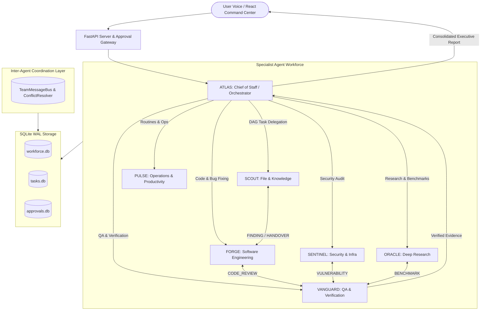

# Jarvis V1 — Autonomous Multi-Agent Workforce Architecture

## 1. Architectural Overview

Jarvis V1 has been transformed from a single-agent assistant into a hierarchical, autonomous multi-agent engineering and operations workforce (the "Avengers" roster). At the center of the architecture is **ATLAS** (Chief of Staff & Team Commander), supported by six specialized autonomous agents: **ORACLE**, **FORGE**, **SENTINEL**, **SCOUT**, **VANGUARD**, and **PULSE**.

---

## 2. Core Architectural Components

### 2.1 ATLAS Orchestrator (`src/openjarvis/workforce/orchestrator.py`)
- **Dynamic Task Planning:** Evaluates incoming user goals and creates dynamic Directed Acyclic Graphs (DAGs) assigning subtasks to domain specialists.
- **Dependency Resolution & Concurrency:** Independent steps execute concurrently; dependent steps block until prerequisite steps pass.
- **Hardware Enveloping:** Parallel worker execution is bounded to `max_workers = 2` to fit within the 4 GB VRAM budget of the NVIDIA GTX 1650.
- **Consolidated Synthesis:** Compiles specialist outputs into structured executive reports with clear findings, actions, and verification certificates.

### 2.2 Agent Workforce Registry (`src/openjarvis/workforce/registry.py`)
- **Singleton Authority:** Tracks the live state, health, active model, and heartbeats of all 7 specialist agents.
- **Dynamic Tool Registration:** Imperatively resolves missing tools (`think`, `knowledge_search`, `n8n`) upon server startup or test fixtures.
- **Stale Agent Sweeper:** Background daemon marks agents `DEGRADED` if heartbeats lapse beyond 120 seconds.
- **Natural Language Status Queries:** Intercepts conversational questions ("How many agents are online?", "What is Forge working on?") and provides live presence answers.
- **Startup Announcement:** Generates spoken readiness summaries respecting user quiet hours (`Asia/Kolkata`).

### 2.3 Team Communication & Conflict Resolution (`src/openjarvis/workforce/communication.py`)
- **Inter-Agent Message Bus:** Standardized messaging types (`FINDING`, `CONTEXT_REQUEST`, `VERIFICATION_REQUEST`, `BLOCKER`, `HANDOVER`).
- **Conflict Resolution Engine:** Automatically detects contradictions between specialists (e.g., discrepancies in bug counts or risk levels) and enforces verification against source evidence.
- **Scoped Context Filtering:** Sanitizes handover context between agents to prevent token bloat and hallucination.

### 2.4 Persistent Task State (`src/openjarvis/tasks/engine.py` & `store.py`)
- **10-State Task State Machine:** (`CREATED`, `PLANNING`, `RUNNING`, `WAITING_APPROVAL`, `PAUSED`, `RECOVERING`, `VERIFYING`, `COMPLETED`, `FAILED`, `CANCELLED`).
- **Crash Recovery:** Interrupted tasks resume from the last completed checkpoint on startup without duplicate side effects.
- **Steering Controls:** Users can dynamically steer active tasks or skip failing steps.

---

## 3. Hardware Boundary Protection (GTX 1650 4 GB VRAM)

| Component | Target Device | Allocation Policy |
| :--- | :--- | :--- |
| **Active LLM Workers** | NVIDIA GTX 1650 | Max 2 concurrent completions; quantized 4-bit / 8-bit models |
| **Speech Pipeline (Whisper/Kokoro)** | AMD Ryzen 5 5600H CPU | Offloaded to CPU to prevent GPU VRAM exhaustion |
| **Routine & Background Scheduling** | System Daemon Threads | Memory footprint < 30 MB; zero GPU allocation |
| **Database Engines** | SQLite WAL | Direct SSD file I/O |

---

## 4. Dynamic Model Intelligence & Resource Governance

Every agent's identity is strictly decoupled from AI model strings. Tasks are dynamically routed by the `ModelSelectionEngine` (`src/openjarvis/models/selector.py`):
- **Model Discovery:** Dynamically detects local vLLM, Ollama, LM Studio, and NIM instances, alongside cloud APIs.
- **Hardware-Aware Allocation:** Enforces 4 GB VRAM ceiling on GTX 1650 and limits local concurrency to 2 simultaneous inferences.
- **Shared Memory Pool:** Models already in GPU memory receive a $+15\text{ point}$ bonus to eliminate unnecessary weight thrashing.
- **Failure Recovery:** Models that encounter runtime failures receive dynamic score penalties and transparently re-route to alternative candidates.

---

## 5. FORGE Coding Engine & OpenCode Integration

FORGE executes software engineering tasks through `ForgeCodingEngine` (`src/openjarvis/workforce/forge_coding.py`):
- **Dual Execution Engine:** Uses headless `OpenCodeAgent` if available (version 1.19.5 on PATH), falling back seamlessly to native `GoalLoop` (`openjarvis/coding/goal.py`).
- **Workspace File Locking:** Prevents concurrent step writes to project files using `WorkspaceLock`.
- **Automated Verification:** Executes `pytest` or `npm test` and measures git diffs before producing verified reports.

---

## 6. n8n Automation Connector & PULSE

PULSE integrates with n8n at `https://n8n.kavlien.store` through `N8nTool` (`src/openjarvis/tools/n8n.py`):
- **Dual Authentication:** Supports API key (`X-N8N-API-KEY`) and session login (`/rest/login` with `emailOrLdapLoginId`).
- **Cookie Caching (6-Day TTL):** Completely prevents HTTP 429 Too Many Requests rate limits.
- **Approval Gating:** Mutating workflow executions are strictly gated by `ApprovalStore`.

---

## 7. Source Files Map

- **Workforce Models:** [src/openjarvis/workforce/models.py](file:///d:/projects/oprn-jarvis/src/openjarvis/workforce/models.py)
- **Workforce Definitions:** [src/openjarvis/workforce/definitions.py](file:///d:/projects/oprn-jarvis/src/openjarvis/workforce/definitions.py)
- **Workforce Persistence:** [src/openjarvis/workforce/store.py](file:///d:/projects/oprn-jarvis/src/openjarvis/workforce/store.py)
- **Workforce Registry:** [src/openjarvis/workforce/registry.py](file:///d:/projects/oprn-jarvis/src/openjarvis/workforce/registry.py)
- **Atlas Orchestrator:** [src/openjarvis/workforce/orchestrator.py](file:///d:/projects/oprn-jarvis/src/openjarvis/workforce/orchestrator.py)
- **Model Discovery:** [src/openjarvis/models/discovery.py](file:///d:/projects/oprn-jarvis/src/openjarvis/models/discovery.py)
- **Model Selector:** [src/openjarvis/models/selector.py](file:///d:/projects/oprn-jarvis/src/openjarvis/models/selector.py)
- **Forge Coding Engine:** [src/openjarvis/workforce/forge_coding.py](file:///d:/projects/oprn-jarvis/src/openjarvis/workforce/forge_coding.py)
- **n8n Automation Tool:** [src/openjarvis/tools/n8n.py](file:///d:/projects/oprn-jarvis/src/openjarvis/tools/n8n.py)
- **Workforce API Endpoints:** [src/openjarvis/server/workforce_routes.py](file:///d:/projects/oprn-jarvis/src/openjarvis/server/workforce_routes.py)
- **Models API Endpoints:** [src/openjarvis/server/models_routes.py](file:///d:/projects/oprn-jarvis/src/openjarvis/server/models_routes.py)
- **n8n API Endpoints:** [src/openjarvis/server/n8n_routes.py](file:///d:/projects/oprn-jarvis/src/openjarvis/server/n8n_routes.py)
- **React Frontend:** [frontend/src/components/Desktop/AgentWorkforce.tsx](file:///d:/projects/oprn-jarvis/frontend/src/components/Desktop/AgentWorkforce.tsx)
- **Model Intelligence Panel:** [frontend/src/components/Desktop/ModelIntelligencePanel.tsx](file:///d:/projects/oprn-jarvis/frontend/src/components/Desktop/ModelIntelligencePanel.tsx)
- **n8n Connector Panel:** [frontend/src/components/Desktop/N8nPanel.tsx](file:///d:/projects/oprn-jarvis/frontend/src/components/Desktop/N8nPanel.tsx)
